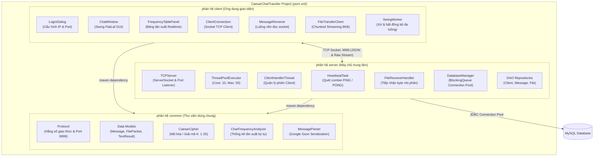
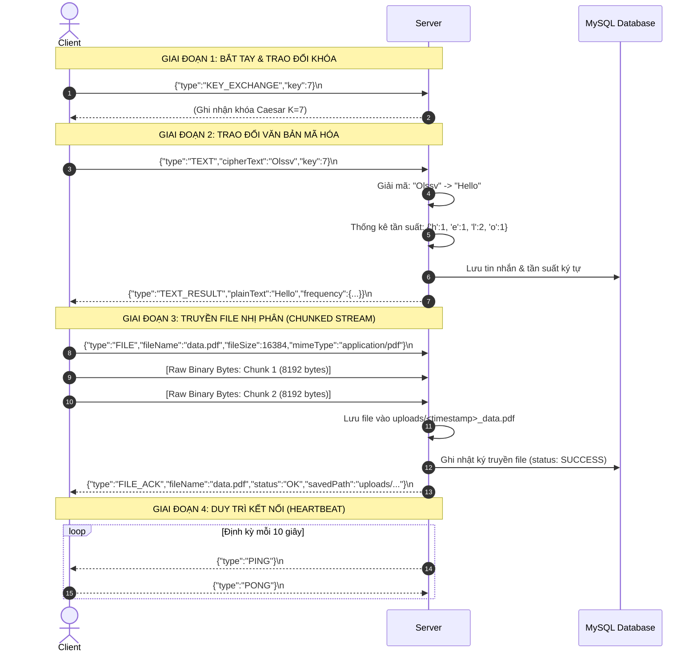
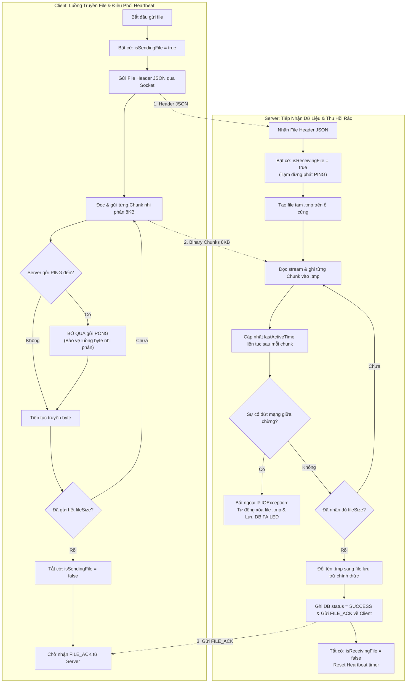
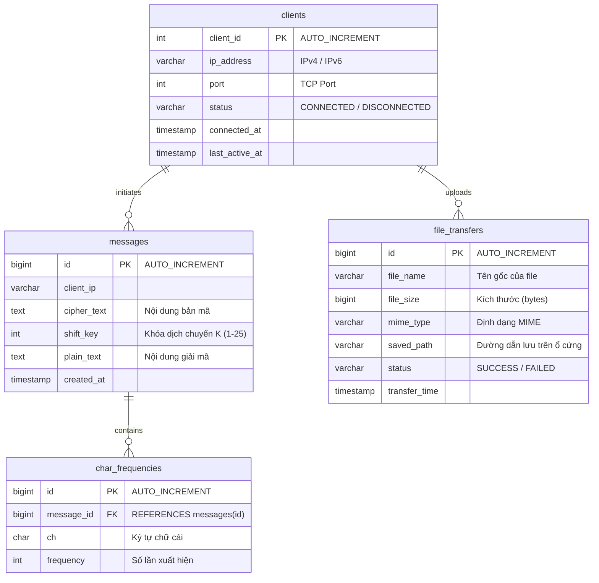
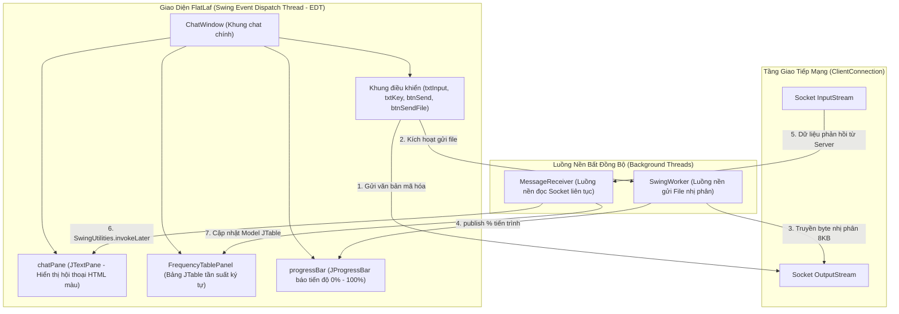
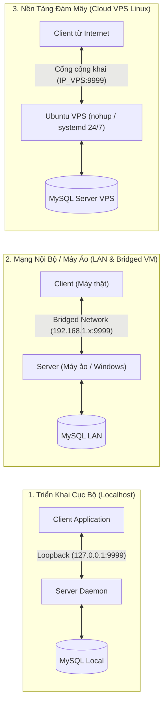

# CaesarChatTransfer

Hệ thống Client-Server đa phân hệ (Multi-module) phát triển bằng **Java 17**, hỗ trợ trao đổi văn bản bảo mật qua thuật toán **Mã hóa Caesar** (kèm phân tích tần suất ký tự trực quan) và **Truyền tải tập tin nhị phân đa luồng** (Chunked Streaming). Hệ thống tích hợp giao diện người dùng đồ họa hiện đại (**Swing FlatLaf**), TCP Socket Server chịu tải cao với **ThreadPool & Heartbeat**, và lưu trữ dữ liệu tập trung với **MySQL Database Connection Pool**.

---

## Mục Lục
1. [Kiến Trúc Hệ Thống](#kiến-trúc-hệ-thống)
2. [Giao Thức Truyền Thông (Protocol Specification)](#giao-thức-truyền-thông-protocol-specification)
3. [Tính Năng Nổi Bật & Kỹ Thuật Chuyên Sâu](#tính-năng-nổi-bật--kỹ-thuật-chuyên-sâu)
4. [Mô Hình Cơ Sở Dữ Liệu (Database Schema)](#mô-hình-cơ-sở-dữ-liệu-database-schema)
5. [Giao Diện Người Dùng (GUI)](#giao-diện-người-dùng-gui)
6. [Hướng Dẫn Cài Đặt & Biên Dịch](#hướng-dẫn-cài-đặt--biên-dịch)
7. [Vận Hành & Triển Khai Thực Tế (Local, LAN, Cloud VPS)](#vận-hành--triển-khai-thực-tế-local-lan-cloud-vps)
8. [Cấu Trúc Thư Mục Dự Án](#cấu-trúc-thư-mục-dự-án)
9. [Thành Viên Thực Hiện (Nhóm 8)](#thành-viên-thực-hiện-nhóm-8)

---

## Kiến Trúc Hệ Thống

Dự án được tổ chức theo chuẩn kiến trúc doanh nghiệp với **3 phân hệ Maven độc lập (Multi-Module Project)**:



### 1. Phân hệ `common` (Thư viện dùng chung)
* **Giao thức mạng (`Protocol.java`)**: Định nghĩa hằng số cổng mặc định (`9999`), kích thước khối dữ liệu (`CHUNK_SIZE = 8192 bytes`), và danh mục định danh thông điệp JSON.
* **Mô hình dữ liệu (`model/`)**: Các POJO `Message`, `FilePacket`, `TextResult` đóng gói dữ liệu trao đổi giữa Client và Server.
* **Bộ tuần tự hóa JSON (`MessageParser.java`)**: Chuyển đổi hai chiều giữa Object và chuỗi JSON thông qua thư viện Google Gson.
* **Thuật toán Caesar Cipher (`CaesarCipher.java`)**: Xử lý mã hóa và giải mã với khóa dịch chuyển $K \in [1, 25]$. Thiết kế bảo toàn ký tự viết hoa/thường, an toàn tuyệt đối với ký tự số, ký tự đặc biệt và ký tự Unicode/Tiếng Việt.
* **Bộ phân tích tần suất (`CharFrequencyAnalyzer.java`)**: Thống kê số lần xuất hiện của các chữ cái trong chuỗi văn bản đã giải mã để phục vụ vẽ biểu đồ và phân tích thám mã.

### 2. Phân hệ `server` (Hạt nhân máy chủ trung tâm)
* **TCPServer & ThreadPoolExecutor**: Quản lý đa kết nối đồng thời với cấu hình `CORE_POOL_SIZE = 10`, `MAX_POOL_SIZE = 50`, `ArrayBlockingQueue(100)` và chính sách hủy kết nối khi quá tải (`AbortPolicy`).
* **Heartbeat Mechanism (`HeartbeatTask.java`)**: Luồng kiểm tra định kỳ 10 giây/lần gửi bản tin `PING`. Tự động thu hồi tài nguyên và cập nhật trạng thái `DISCONNECTED` đối với các client không phản hồi `PONG` (zombie client).
* **Điều phối luồng truyền nhận file (`FileReceiverHandler.java`)**: Tiếp nhận luồng byte nhị phân chunked 8KB, lưu trữ vào đĩa cứng và bảo đảm cập nhật timestamp kết nối liên tục nhằm tránh timeout. Tự động xóa file tạm `.tmp` nếu đường truyền bị gián đoạn.
* **Database Connection Pool (`DatabaseManager.java`)**: Tự xây dựng hồ kết nối CSDL luồng an toàn (Thread-Safe) bằng `ArrayBlockingQueue<Connection>`, tự động tải cấu hình từ classpath hoặc file ngoại vi `db.properties`.
* **Tầng truy cập dữ liệu (DAO/Repository)**: Gồm `ClientRepository`, `MessageRepository`, `FileRepository` sử dụng `PreparedStatement` chống tấn công SQL Injection.

### 3. Phân hệ `client` (Ứng dụng người dùng)
* **Giao diện người dùng đồ họa (`gui/`)**:
  - `LoginDialog`: Hộp thoại kết nối hỗ trợ cấu hình động IP máy chủ và Port (mặc định sẵn IP Cloud VPS).
  - `ChatWindow`: Cửa sổ trò chuyện chính hiển thị lịch sử bằng HTML styled pane, khung nhập khóa Caesar (1–25), ô nhập văn bản và nút gửi file.
  - `FrequencyTablePanel`: Bảng hiển thị tần suất ký tự thời gian thực dạng `JTable`.
* **Luồng xử lý bất đồng bộ (`SwingWorker`)**: Đẩy toàn bộ tác vụ truyền file nhị phân vào luồng nền, kết hợp `JProgressBar` báo cáo tiến độ 0%–100%, giữ cho giao diện luôn mượt mà.
* **Luồng nhận tin nền (`MessageReceiver.java`)**: Đọc dữ liệu từ Server trên luồng độc lập với Event Dispatch Thread (EDT) của Swing.

---

## Giao Thức Truyền Thông (Protocol Specification)

Hệ thống sử dụng **TCP Socket** với định dạng gói tin **JSON phân tách bằng ký tự xuống dòng (`\n`)**, riêng dữ liệu file nhị phân được truyền dạng byte thô (Raw Binary Stream) ngay sau gói tin Header.



### Chi tiết các bản tin:

1. **Trao đổi khóa (`KEY_EXCHANGE`)**
   ```json
   {"type": "KEY_EXCHANGE", "key": 7}
   ```
2. **Gửi tin nhắn mã hóa (`TEXT`)**
   ```json
   {"type": "TEXT", "cipherText": "Khoor Zruog", "key": 3}
   ```
3. **Phản hồi giải mã & tần suất (`TEXT_RESULT`)**
   ```json
   {
     "type": "TEXT_RESULT",
     "plainText": "Hello World",
     "frequency": {"d": 1, "e": 1, "h": 1, "l": 3, "o": 2, "r": 1, "w": 1}
   }
   ```
4. **Header truyền file (`FILE`)**
   ```json
   {
     "type": "FILE",
     "fileName": "report.pdf",
     "fileSize": 1048576,
     "mimeType": "application/pdf"
   }
   ```
   *(Ngay sau dấu `\n` của header này là $1,048,576$ bytes dữ liệu nhị phân gửi theo từng khối 8KB).*
5. **Xác nhận nhận file (`FILE_ACK`)**
   ```json
   {
     "type": "FILE_ACK",
     "fileName": "report.pdf",
     "status": "OK",
     "savedPath": "uploads/1730000000000_report.pdf"
   }
   ```
6. **Kiểm tra sống còn (`PING` / `PONG`)**
   ```json
   {"type": "PING"}
   {"type": "PONG"}
   ```
7. **Báo lỗi từ Server (`ERROR`)**
   ```json
   {"type": "ERROR", "message": "Caesar key must be between 1 and 25."}
   ```

---

## Tính Năng Nổi Bật & Kỹ Thuật Chuyên Sâu

### 1. Phối Hợp Heartbeat & Binary Streaming Độc Quyền (Heartbeat Coordination)
* **Vấn đề kỹ thuật:** Khi Client đang truyền một file lớn (hàng chục MB) bằng luồng byte nhị phân qua cùng 1 socket TCP, nếu Server gửi bản tin `PING`, Client thông thường sẽ tự động phản hồi `PONG` (16 bytes chuỗi). Chuỗi này sẽ bị **bơm thẳng vào giữa luồng dữ liệu file**, làm biến dạng file và khiến Server đọc nhầm JSON thành byte dữ liệu, dẫn tới lỗi `JsonSyntaxException` và sập socket.
* **Giải pháp trong dự án:**
  - **Client-Side:** Sử dụng cờ nguyên tử `AtomicBoolean isSendingFile`. Khi đang truyền file, Client tự động tạm hoãn gửi `PONG` để bảo vệ luồng nhị phân nguyên vẹn 100%. Đồng thời vô hiệu hóa việc nhập text/file song song trên UI.
  - **Server-Side:** Server nhận diện cờ `isReceivingFile`, tạm dừng phát `PING` tới socket đang bận. Mỗi khi nhận 1 chunk byte (`read > 0`), Server tự động làm mới mốc thời gian hoạt động (`updateLastActiveTime()`). Nếu đường truyền bị treo quá 60s không có byte nào mới, Server mới kích hoạt timeout dọn dẹp.



### 2. Tự Động Thu Hồi Rác File Tạm
* Dữ liệu file tải lên ban đầu được ghi vào file tạm có đuôi `.tmp` (`<timestamp>_<filename>.tmp`).
* Nếu quá trình truyền file bị ngắt giữa chừng (mất điện, tắt mạng, client đóng app), khối lệnh `catch (IOException)` tại Server sẽ tự động xóa ngay lập tức file tạm khỏi ổ cứng và cập nhật trạng thái trong CSDL là `FAILED`.
* Chỉ khi toàn bộ số byte nhận được đúng bằng `fileSize`, file mới được đổi tên sang đường dẫn lưu trữ chính thức và đánh dấu `SUCCESS`.

### 3. Tự Xây Dựng Database Connection Pool
* Không phụ thuộc vào thư viện bên thứ ba (như HikariCP, DBCP), dự án tự triển khai Connection Pool bằng cấu trúc `ArrayBlockingQueue<Connection>`:
  - Khởi tạo sẵn một số lượng kết nối cố định đến MySQL.
  - Sử dụng cơ chế mượn (`getConnection()`) và trả (`releaseConnection()`) an toàn luồng với thời gian chờ tối đa (timeout).
  - Tự động kiểm tra trạng thái sống của kết nối trước khi bàn giao cho luồng DAO.

---

## Mô Hình Cơ Sở Dữ Liệu (Database Schema)

Hệ thống sử dụng MySQL với 4 bảng được thiết kế chuẩn hóa:



---

## Giao Diện Người Dùng (GUI)

Ứng dụng Client được thiết kế trên nền **Java Swing** kết hợp bộ giao diện hiện đại **FlatLaf**:
* **Theme phẳng & Tương phản chuẩn:** Giao diện bo góc, phân tách rõ ràng giữa các phân vùng thao tác.
* **Màn hình Chat HTML:** Phân biệt trực quan màu sắc thông điệp:
  - <span style="color:#005a9e">■</span> **Me (Plain):** Văn bản gốc phía người gửi.
  - <span style="color:#0078d4">■</span> **Me (Cipher):** Bản mã đã được mã hóa Caesar gửi qua mạng.
  - <span style="color:#107c10">■</span> **Server (Plain):** Văn bản sau khi Server giải mã thành công.
  - <span style="color:#d13438">■</span> **Error / Disconnected:** Thông báo lỗi hệ thống hoặc cảnh báo mất mạng.
* **Bảng tần suất ký tự (`FrequencyTablePanel`):** Bảng số liệu tự động cập nhật ngay khi nhận gói tin `TEXT_RESULT`.
* **Thanh tiến trình thông minh (`JProgressBar`):** Hiển thị % truyền tải khi gửi file và tự động ẩn khi hoàn tất.



---

## Hướng Dẫn Cài Đặt & Biên Dịch

### 1. Yêu cầu môi trường
* **Java Development Kit (JDK)**: Phiên bản 17 trở lên.
* **Apache Maven**: Phiên bản 3.9 trở lên.
* **MySQL Server**: Phiên bản 8.x.

### 2. Thiết lập Cơ sở dữ liệu (MySQL)
1. Mở MySQL Workbench hoặc Terminal và tạo CSDL:
   ```sql
   CREATE DATABASE IF NOT EXISTS caesar_chat_db;
   USE caesar_chat_db;
   ```
2. Thực thi toàn bộ nội dung file [`server/src/main/resources/schema.sql`](server/src/main/resources/schema.sql) để tạo 4 bảng: `clients`, `messages`, `char_frequencies`, `file_transfers`.
3. Kiểm tra thông tin đăng nhập trong file `server/src/main/resources/db.properties` (hoặc đặt file `db.properties` cùng cấp với file JAR khi chạy):
   ```properties
   db.driver=com.mysql.cj.jdbc.Driver
   db.url=jdbc:mysql://localhost:3306/caesar_chat_db?useSSL=false&allowPublicKeyRetrieval=true&serverTimezone=UTC
   db.username=root
   db.password=MatKhauCuaBan
   db.pool.size=5
   ```

### 3. Biên dịch và Đóng gói (Fat JAR)
Mở terminal tại thư mục gốc của dự án:

```bash
# 1. Chạy toàn bộ 71 Unit & Integration Tests:
mvn clean test

# 2. Đóng gói ra 2 file Fat JAR độc lập:
mvn clean package -DskipTests
```

Sau khi đóng gói thành công, sản phẩm sẽ nằm tại:
* Server Fat JAR: `server/target/server-1.0.0-SNAPSHOT.jar`
* Client Fat JAR: `client/target/client-1.0.0-SNAPSHOT.jar`

---

## Vận Hành & Triển Khai Thực Tế (Local, LAN, Cloud VPS)



### 1. Chạy trên máy cục bộ (Localhost)
* **Khởi động Server:**
  ```bash
  java -jar server/target/server-1.0.0-SNAPSHOT.jar
  # Hoặc chạy trực tiếp class com.tcpchat.server.ServerMain từ IDE
  ```
* **Khởi động Client:**
  ```bash
  java -jar client/target/client-1.0.0-SNAPSHOT.jar
  # Hoặc chạy class com.tcpchat.client.ClientMain từ IDE
  ```
  *Tại hộp thoại đăng nhập:* Nhập IP `127.0.0.1` và Port `9999`.

---

### 2. Triển khai trong mạng LAN / Máy ảo (VMware / VirtualBox)
1. Cấu hình card mạng của máy ảo sang chế độ **Bridged Adapter** để máy ảo nhận IP cùng dải mạng nội bộ với máy thật.
2. Trên máy chạy Server, mở Inbound Port `9999` trên Firewall:
   - **Windows:** Mở *Windows Defender Firewall with Advanced Security* -> *Inbound Rules* -> *New Rule* -> Chọn *Port*, TCP `9999` -> *Allow the connection*.
3. Máy Client nhập địa chỉ IPv4 nội bộ của máy Server (ví dụ: `192.168.1.50:9999`).

---

### 3. Triển khai lên Cloud VPS (Ubuntu / Debian Linux)
Hệ thống sẵn sàng chạy 24/7 trên môi trường Production Cloud VPS:

1. **Cài đặt môi trường trên VPS:**
   ```bash
   sudo apt update
   sudo apt install -y openjdk-17-jre-headless mysql-server
   ```
2. **Cấu hình CSDL MySQL trên VPS:**
   ```bash
   sudo mysql -u root
   # Chạy lệnh tạo CSDL và import file schema.sql
   ```
3. **Mở cổng 9999 trên Firewall:**
   ```bash
   sudo ufw allow 9999/tcp
   sudo ufw reload
   ```
   *(Lưu ý: Mở thêm cổng `9999` trong Security Groups / Ingress Rules trên trang quản trị của nhà cung cấp VPS như AWS, GCP, DigitalOcean, Oracle Cloud...)*
4. **Tải file lên VPS và chạy nền 24/7:**
   Đẩy 3 file: `server-1.0.0-SNAPSHOT.jar`, `schema.sql`, `db.properties` vào cùng thư mục trên VPS:
   ```bash
   # Chạy nền với nohup:
   nohup java -jar server-1.0.0-SNAPSHOT.jar > server.log 2>&1 &
   
   # Kiểm tra tiến trình đang chạy:
   ps aux | grep java
   ```
5. **Kết nối:** Bất kỳ Client nào từ khắp nơi có kết nối Internet đều có thể nhập địa chỉ `IP_VPS` và port `9999` để trò chuyện và truyền file.

---

## Cấu Trúc Thư Mục Dự Án

```text
CaesarChatTransfer/
├── pom.xml                                      # Maven Root quản lý đa phân hệ
├── README.md                                    # Tài liệu kỹ thuật chi tiết toàn diện
├── SETUP.md                                     # Hướng dẫn từng bước cho người mới
│
├── common/                                      # Phân hệ dùng chung (Common)
│   ├── pom.xml
│   └── src/
│       ├── main/java/com/tcpchat/common/
│       │   ├── analysis/CharFrequencyAnalyzer.java
│       │   ├── crypto/CaesarCipher.java
│       │   ├── model/
│       │   │   ├── FilePacket.java
│       │   │   ├── Message.java
│       │   │   └── TextResult.java
│       │   ├── MessageParser.java
│       │   └── Protocol.java
│       └── test/java/com/tcpchat/common/
│           ├── analysis/CharFrequencyAnalyzerTest.java
│           ├── crypto/CaesarCipherTest.java
│           └── MessageParserTest.java
│
├── client/                                      # Phân hệ Máy khách (Client)
│   ├── pom.xml                                  # Đóng gói Client Fat JAR
│   └── src/
│       ├── main/java/com/tcpchat/client/
│       │   ├── gui/
│       │   │   ├── ChatWindow.java              # Cửa sổ chat chính FlatLaf
│       │   │   ├── FrequencyTablePanel.java     # Bảng phân tích tần suất
│       │   │   └── LoginDialog.java             # Hộp thoại kết nối
│       │   ├── transfer/FileTransferClient.java # Bộ truyền file Streaming
│       │   ├── ClientConnection.java            # Quản lý Socket TCP Client
│       │   ├── ClientMain.java                  # Điểm khởi chạy Client
│       │   ├── MessageListener.java             # Interface callback sự kiện
│       │   ├── MessageReceiver.java             # Luồng nền đọc socket
│       │   └── ProgressListener.java            # Interface báo cáo tiến độ
│       └── test/java/com/tcpchat/client/
│           ├── transfer/FileTransferClientTest.java
│           ├── ClientConnectionTest.java
│           └── MessageReceiverTest.java
│
└── server/                                      # Phân hệ Máy chủ (Server)
    ├── pom.xml                                  # Đóng gói Server Fat JAR
    └── src/
        ├── main/
        │   ├── java/com/tcpchat/server/
        │   │   ├── config/ServerConfig.java     # Cấu hình hằng số hệ thống
        │   │   ├── db/
        │   │   │   ├── ClientRepository.java    # DAO quản lý client
        │   │   │   ├── DatabaseManager.java     # Thread-safe Connection Pool
        │   │   │   ├── FileRepository.java      # DAO lưu vết truyền file
        │   │   │   └── MessageRepository.java   # DAO lưu trữ tin nhắn & tần suất
        │   │   ├── network/
        │   │   │   ├── ClientHandlerThread.java # Luồng xử lý giao tiếp client
        │   │   │   ├── HeartbeatTask.java       # Luồng quét zombie PING/PONG
        │   │   │   ├── MessageParser.java
        │   │   │   └── TCPServer.java           # Socket Server & ThreadPool
        │   │   ├── transfer/FileReceiverHandler.java # Tiếp nhận luồng byte file
        │   │   └── ServerMain.java              # Điểm khởi chạy Server duy nhất
        │   └── resources/
        │       ├── db.properties                # Cấu hình kết nối MySQL
        │       └── schema.sql                   # Kịch bản DDL khởi tạo CSDL
        └── test/java/com/tcpchat/server/
            ├── config/ServerConfigTest.java
            ├── db/
            │   ├── ClientRepositoryTest.java
            │   ├── DatabaseManagerTest.java
            │   ├── FileRepositoryTest.java
            │   └── MessageRepositoryTest.java
            ├── network/
            │   ├── ClientHandlerThreadTest.java
            │   ├── EndToEndIntegrationTest.java# Test tích hợp luồng trọn vẹn
            │   ├── HeartbeatTaskTest.java
            │   ├── MessageParserTest.java
            │   └── TCPServerTest.java
            └── transfer/FileReceiverHandlerTest.java
```

---

## Thành Viên Thực Hiện (Nhóm 8)

Dự án được xây dựng và hoàn thiện bởi các thành viên **Nhóm 8**:

| STT | Mã Sinh Viên | Họ và Tên | Vai trò |
| :---: | :---: | :--- | :--- |
| 1 | **N24DTCN021** | **Trần Hoàng Duy** | Trưởng nhóm |
| 2 | **N24DTCN001** | **Nguyễn Quang Anh** | Thành viên |
| 3 | **N24DTCN106** | **Trần Minh Đức** | Thành viên |
| 4 | **N24DTCN040** | **Nguyễn Gia Huy** | Thành viên |
| 5 | **N24DTCN008** | **Đoàn Nhật Cường** | Thành viên |
| 6 | **N24DTCN041** | **Phạm Quang Huy** | Thành viên |

---

## Giấy Phép & Bản Quyền (License)
* Dự án được phát triển phục vụ mục đích học thuật và nghiên cứu cho đồ án môn học.
* Mã nguồn được phát hành chính thức theo giấy phép [MIT License](LICENSE). Xem chi tiết tại tệp [LICENSE](LICENSE).
